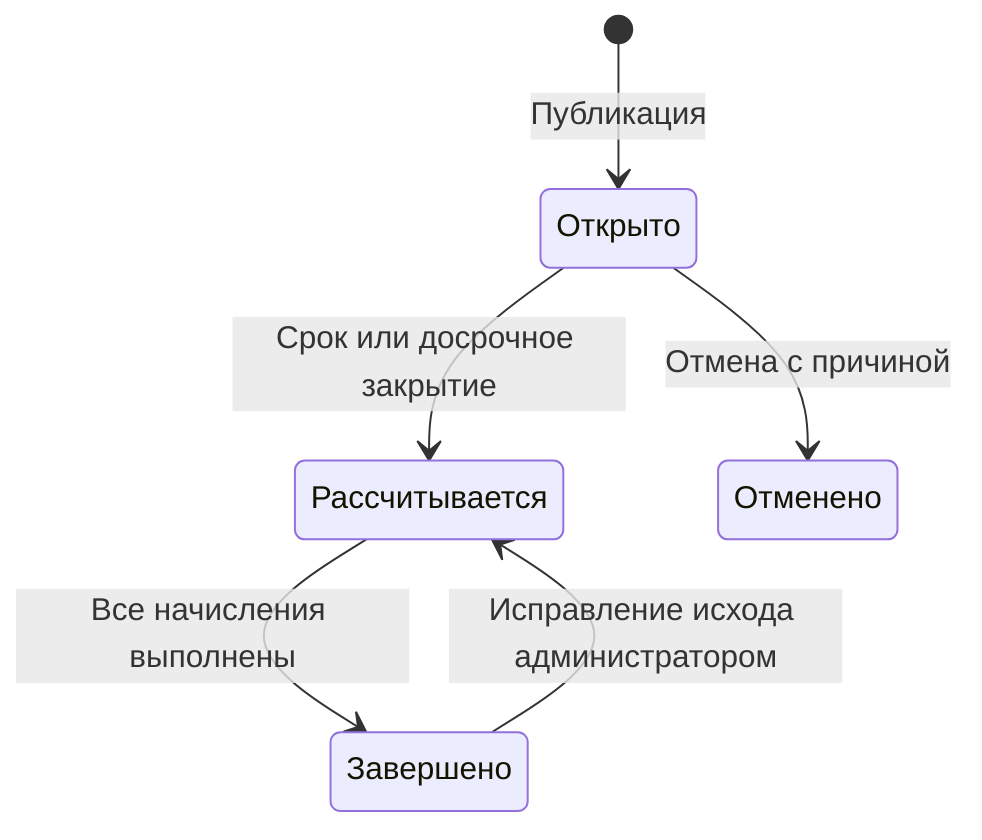

**Predictify** — веб-платформа для прогнозирования исходов событий и соревнования в рейтинге участников. Пользователь выбирает один из предложенных исходов и получает виртуальные очки за верный прогноз. Количество очков зависит от коэффициента, рассчитанного по распределению прогнозов участников.

Проект вдохновлён Polymarket. Денежные ставки, платежи и вывод средств отсутствуют. Создание прогноза не расходует виртуальные очки, а неверный прогноз не уменьшает накопленный баланс.

## Команда

**Учебная группа:** СДП-ПМАТ-241.

| Участники: |
| --- |
| Гайдук В.А. |
| Видук И.А. |
| Барашко Е.С. |
| Орлюк М.А. |

## Функциональные требования

### Роли и доступ

| Роль | Возможности |
| --- | --- |
| Гость | Просмотр категорий, событий, коэффициентов, результатов и лидерборда; регистрация, вход и восстановление пароля. |
| Зарегистрированный пользователь | Публичный просмотр, создание и изменение своего прогноза, личный кабинет, история прогнозов, изменение публичного имени, пароля и аватарки. |
| Модератор | Все функции пользователя; создание и публикация событий в назначенных активных категориях; допустимые уточнения текста, закрытие, отмена и подтверждение исходов событий своих категорий; просмотр соответствующего журнала действий. |
| Администратор | Все функции пользователя и управление событиями любых категорий; управление категориями, назначение и снятие модераторов, изменение их категорий, исправление результатов и просмотр полного журнала действий. |

Роль и назначения категорий проверяются при каждой операции на сервере. Обычная регистрация создаёт пользователя с нулевым балансом и не позволяет выбрать служебную роль. После снятия полномочий доступ прекращается сразу, а события, прогнозы и очки сохраняются.

### Функциональные требования

| ID | Требование |
| --- | --- |
| FR-01 | Регистрация по уникальному адресу электронной почты и паролю с указанием публичного имени; вход, выход и восстановление пароля. |
| FR-02 | Изменение публичного имени и пароля в личном кабинете; загрузка, замена и удаление аватарки. При отсутствии аватарки отображается стандартная иконка. Электронная почта и личная история не публикуются для других участников. |
| FR-03 | Просмотр каталога и карточки события; поиск по заголовку, фильтрация по категории и статусу. Для события отображается изображение, если оно задано; иначе используется заглушка. |
| FR-04 | Управление категориями администратором: создание, переименование, изменение описания, архивирование и восстановление. Названия уникальны без учёта регистра и лишних пробелов. Удаление допустимо только при отсутствии связанных событий. |
| FR-05 | Назначение и снятие модераторов администратором. Модератор может иметь несколько категорий; у категории может быть несколько модераторов. |
| FR-06 | Создание, редактирование и удаление собственных черновиков модератором. Черновики доступны автору и администратору; публично они не отображаются. |
| FR-07 | Публикация события с вопросом, одной активной категорией, минимум двумя уникальными взаимоисключающими исходами, сроком приёма прогнозов, ожидаемой датой результата, критериями и источником проверки. При создании события можно прикрепить необязательное изображение. Предварительное одобрение администратора не требуется. |
| FR-08 | После публикации нельзя менять смысл вопроса, категорию, варианты ответа, срок приёма прогнозов и критерии результата. Допускаются опечатки и разъяснения без изменения условий с сохранением истории изменений. Модератор категории или администратор может добавить, заменить или удалить изображение без изменения смысла события с записью действия в журнал. |
| FR-09 | Один действующий прогноз пользователя на событие. До закрытия выбор можно заменить; учитывается последний сохранённый исход. Полный отзыв прогноза в первой версии не предусмотрен. |
| FR-10 | Автоматический пересчёт распределения и текущих коэффициентов после создания или изменения прогноза. Повторные и параллельные запросы не создают дополнительные прогнозы или голоса. |
| FR-11 | Перед подтверждением прогноза отображаются исход, текущий коэффициент, предварительная награда и срок закрытия с часовым поясом. После сохранения показываются текущий выбор и время его изменения. |
| FR-12 | Автоматическое прекращение приёма прогнозов по сроку и досрочное закрытие модератором категории или администратором с обязательной причиной. При закрытии фиксируются последние прогнозы и итоговые коэффициенты; повторное открытие запрещено. |
| FR-13 | Подтверждение одного правильного исхода модератором категории или администратором после закрытия приёма прогнозов. Сохраняются исполнитель, время, объяснение и источник подтверждения. |
| FR-14 | Однократное начисление очков за верный прогноз по итоговому коэффициенту. За неверный прогноз начисляется 0 очков. При сбое расчёт возобновляется без повторных начислений. |
| FR-15 | Отмена открытого или ожидающего результата события модератором категории или администратором с обязательной причиной. Прогнозы сохраняются; награды и штрафы отсутствуют; отменённые события не учитываются в точности. |
| FR-16 | Исправление результата завершённого события либо его отмена только администратором с указанием причины. Прежние начисления этого события отменяются, новые рассчитываются по исходным итоговым коэффициентам; история и рейтинг обновляются согласованно. |
| FR-17 | Общий лидерборд за всё время и фильтр по категории: место, публичное имя, сумма очков и число верных прогнозов. При равных очках места одинаковы, например 1, 1, 3. Пользователь может найти своё место. |
| FR-18 | Личный кабинет с аватаркой пользователя, балансом, местом в рейтинге и историей активных, ожидающих, верных, неверных и отменённых прогнозов. Для каждой записи показываются выбор, коэффициент, результат и начисление. |
| FR-19 | Панели модератора и администратора с доступными категориями, черновиками, событиями и операциями в пределах полномочий. В архивной категории новые события не создаются и не публикуются; ранее опубликованные могут быть завершены. |
| FR-20 | Журнал публикаций, закрытий, отмен, назначений, подтверждений и исправлений с исполнителем, временем, объектом, причиной и изменёнными значениями. |

### Изображения и аватарки

Аватарка профиля и изображение события необязательны. Файлы хранятся в MinIO, а их ключи — в полях `users.avatar_key` и `events.image_key` типа `varchar(255)`, допускающих `NULL`. Каждому пользователю соответствует не более одной аватарки, каждому событию — не более одного изображения.

Backend формирует URL для отображения файлов; временные ссылки MinIO в базе данных не сохраняются. При удалении аватарки или изображения соответствующее поле получает значение `NULL`, а интерфейс показывает стандартную иконку или заглушку. Сервер проверяет формат и размер загружаемых файлов.

### Правила коэффициентов и начисления очков

Коэффициент исхода:
K = N / n, но не больше 10
(N — всего прогнозов, n — прогнозов на этот исход)
Округляем до 2 знаков (0,005 и выше — вверх).

Очки:
Угадал → 100 × K
Не угадал → 0

Крайние случаи:
· Пока никто не голосовал (N = 0) → K = число вариантов (но не больше 10)
· На исход никто не поставил (n = 0) → K = 10

Пример: 10 человек, 8 за A, 2 за B → K(A) = 1,25; K(B) = 5,00. Если верно B — каждый получит 100 × 5 = 500 очков.

Отмена ошибочного начисления при исправлении результата относится только к соответствующему событию. Дополнительный штраф за неверный прогноз не применяется, произвольное изменение общего баланса запрещено.

### Жизненный цикл события



В момент сохранения прогноза серверное время должно быть строго меньше срока закрытия. Перенос ожидаемой даты результата не возобновляет приём прогнозов и не меняет зафиксированные коэффициенты. При задержке результата событие остаётся в ожидании; автоматический выбор исхода не выполняется.

## Use Case диаграмма


Пустой треугольник направлен к роли, чьи функции наследуются: модератор наследует функции пользователя, администратор — модератора с полномочиями по всем категориям. Гость и пользователь отдельно связаны с публичным просмотром. Автоматическое начисление очков и обновление рейтинга выполняются системой после подтверждения исхода.

## Предполагаемый технологический стек

| Компонент | Технологии | Назначение |
| --- | --- | --- |
| Frontend | React, TypeScript | Пользовательский интерфейс, каталог, прогнозы, личный кабинет и панели управления. |
| Backend | NodeJs | Серверный API, авторизация, разграничение доступа, события, прогнозы и расчёт очков. |
| База данных | PostgreSQL | Аккаунты, категории, назначения, события, прогнозы, коэффициенты, начисления и журнал действий. |
| Объектное хранилище | MinIO | Хранение изображений событий и аватарок пользователей; в PostgreSQL сохраняются ключи объектов. |
| Развёртывание | Docker Compose | Совместный запуск приложения и инфраструктурных сервисов в контейнерах. 


## Запуск через Docker Compose

Из корня репозитория скопируйте пример окружения в рабочий `.env`.

```sh
cp .env.example .env
```

Заполните `POSTGRES_PASSWORD` и `MINIO_ROOT_PASSWORD` разными значениями. Для каждого пароля можно выполнить `openssl rand -hex 24`. Используйте в пароле PostgreSQL только URL-безопасные символы, поскольку пароль входит в строку подключения backend. Порты на `127.0.0.1` можно переопределить в `.env`.

Режим разработки использует `compose.override.yml` автоматически. Правки в каталогах `src` frontend и backend подхватываются при работающих контейнерах. После изменений зависимостей или конфигурации повторите команду с `--build`.

```sh
docker compose up -d --build --wait
```

Для проверки собранного приложения укажите только основной файл.

```sh
docker compose -f compose.yml up -d --build --wait
```

При стандартных портах frontend доступен по адресу `http://127.0.0.1:5173`, консоль MinIO — `http://127.0.0.1:9001`. Проверить готовность API через frontend можно командой `curl -fsS http://127.0.0.1:5173/api/ready`.

Миграции применяются при запуске до старта backend. В режиме разработки их также можно запустить вручную.

```sh
docker compose run --rm migrate
```

Для собранного режима добавьте `-f compose.yml` после `docker compose`. Остановить сервисы с сохранением именованных томов можно через `docker compose down`. При смене режима выполните `down` перед запуском с другим набором файлов.

Если PostgreSQL ранее запускался через Compose из каталога backend, сделайте `pg_dump` и остановите старый контейнер. Запустите только новый PostgreSQL командой `docker compose up -d --wait postgres`, восстановите дамп и затем запустите все сервисы.

## Запуск frontend

Установите Node.js 24 и выполните из корня репозитория.

```sh
npm ci
npm run dev -w frontend
```

Откройте адрес, который выведет Vite. Оболочка и заглушки публичных страниц запускаются без backend. На `/dev/ui` доступны примеры всех общих компонентов и состояний.

```sh
npm run test -w frontend
npm run build -w frontend
npm run preview -w frontend
```

Сборка проверяет типы и записывает результат в `frontend/dist`. Команда `preview` позволяет проверить собранное приложение локально.

### Структура и подключение модулей

- `frontend/src/app` содержит общий layout, навигацию, базовые стили и таблицу маршрутов в `routes.tsx`.
- `frontend/src/features` содержит страницы и код отдельных модулей. Добавляйте экраны в каталог своего модуля и регистрируйте их в общей таблице маршрутов.
- `frontend/src/shared` содержит общий API-клиент и компоненты интерфейса. Поведение отдельного модуля остаётся в `features`.

| Модуль | Точка подключения |
| --- | --- |
| Каталог и карточка события (#11) | Заменить заглушку `/events`, добавить `/events/:eventId`. |
| Прогнозы (#15) | Подключить форму и состояние прогноза на странице `/events/:eventId`. |
| Аккаунты и сессии (#6, #7) | Добавить `/login`, `/register`, `/forgot-password`, `/reset-password` и `/profile`. |
| Панели управления (#8, #10, #12) | Подключить `/admin` и `/moderation` вместе с проверками доступа модуля аккаунтов. |
| Рейтинг и история (#21, #22) | Заменить заглушку `/leaderboard`, добавить историю прогнозов на `/profile`. |

### Общие компоненты

Импортируйте `Button`, `TextField`, `Textarea`, `Modal`, `LoadingState`, `ErrorState` и `EmptyState` из `shared/ui`, используя относительный путь от своего модуля.

```tsx
<>
  <TextField label="Публичное имя" name="displayName" error={nameError} />
  <Button onClick={() => setIsOpen(true)}>Сохранить</Button>
  <Modal title="Подтверждение" open={isOpen} onClose={() => setIsOpen(false)}>
    <p>Сохранить изменения?</p>
    <Button onClick={save}>Подтвердить</Button>
  </Modal>
  <ErrorState description="Сервис временно недоступен." onRetry={reload} />
</>
```

Поля передают стандартные атрибуты элементам формы. `Button` по умолчанию имеет тип `button`. `Modal` управляется через `open` и вызывает `onClose` по кнопке и `Escape`. `LoadingState` сообщает о загрузке, а `EmptyState` показывает пустой результат и при необходимости принимает действие через `action`.

### API и размещение

Импортируйте `apiRequest` и `ApiError` из `shared/api/apiRequest`. Передавайте путь от базы API с начальной `/`, параметры запроса через `URLSearchParams`, данные через `json` или `body`, а сигнал отмены через `signal`.

```ts
const query = new URLSearchParams({ limit: '20' });
const events = await apiRequest<EventSummary[]>(`/events?${query}`, { signal });
```

Это пример вызова для модуля каталога. Ответ с JSON возвращается как тип `T`, заданный вызывающим модулем. Для `204` используйте `apiRequest<void>`. `ApiError.kind` различает `http`, `network` и `invalid-json`. Для HTTP-ошибок доступны `status` и `details`. Отмена запроса передаётся вызывающему коду в исходном виде.

По умолчанию клиент обращается к `/api` на том же адресе, что и приложение. Скопируйте `frontend/.env.example` в `frontend/.env.local`, если нужно задать `API_PROXY_TARGET` для локального backend. Vite проксирует `/api` с сохранением префикса. `VITE_API_BASE_URL` при необходимости переопределяет базу при сборке. Эта переменная публичная.

В Compose `vite dev` и `vite preview` проксируют `/api` и `/api/*` в backend. Режим `preview` раздаёт `frontend/dist` и поддерживает прямые переходы по маршрутам приложения, например `/leaderboard`. Учётные данные и формат доменных ответов определяют соответствующие модули.

## Проверки качества

Для локального запуска установите Node.js 24 и выполните команды из корня репозитория.

```sh
npm ci
npm run lint
npm run format:check
```

ESLint проверяет код в `frontend/` и `backend/`. Prettier проверяет форматирование файлов приложений и конфигурации инструментов. Чтобы применить форматирование, выполните `npm run format`.

Пишите сообщения коммитов по [Conventional Commits](https://www.conventionalcommits.org/), например `feat(frontend): add event filters` или `fix(backend): validate event deadline`.

Перед открытием PR в `develop` проверьте сообщения коммитов локально.

```sh
git fetch origin
npm run commitlint -- --from origin/develop --to HEAD
```

Для PR в `main` используйте `origin/main` вместо `origin/develop`. GitHub Actions запускает линтинг, проверку форматирования и проверку сообщений коммитов для обеих целевых веток.

Ветки `features/*` вливаются в `develop`, а `develop` в `main` через **Create a merge commit**. Commitlint проверяет обычные коммиты, которые PR добавляет в целевую ветку. Git исключает служебные merge-коммиты по числу родителей.
