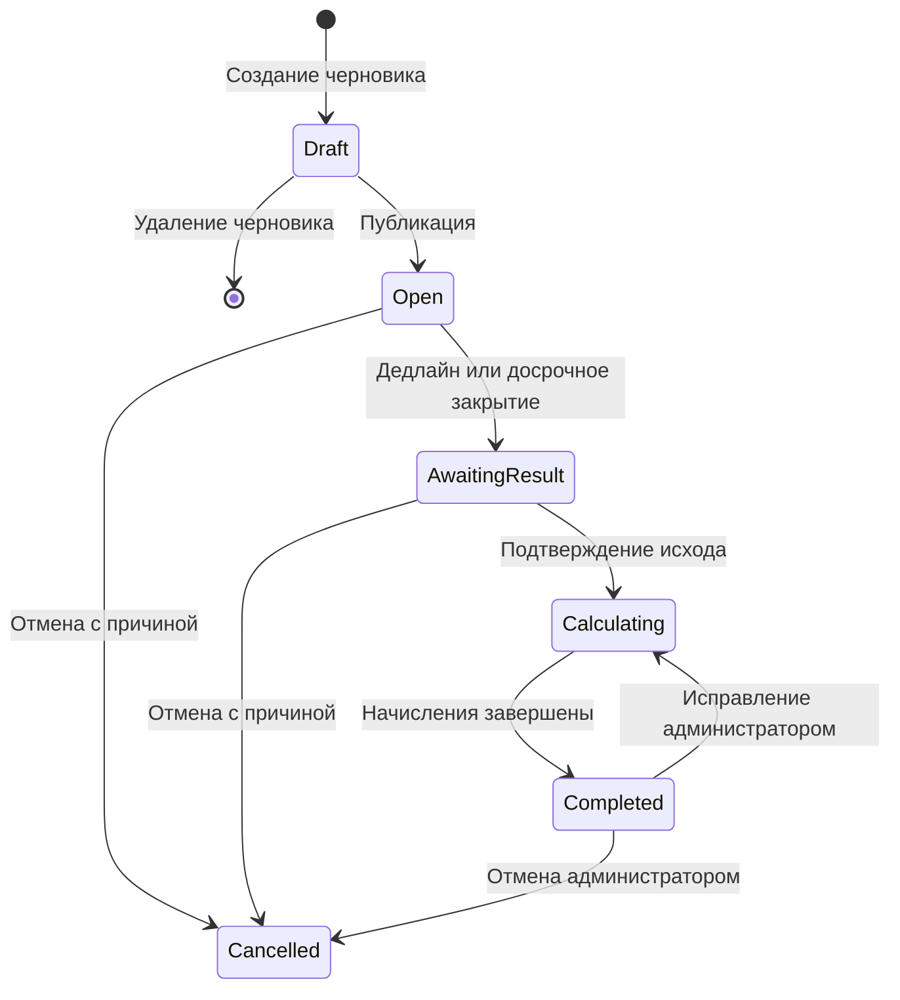

# Категории и жизненный цикл события

Контракт для [#10](https://github.com/miatniykaras13/Predictify/issues/10) (категории), [#11](https://github.com/miatniykaras13/Predictify/issues/11) (каталог), [#12](https://github.com/miatniykaras13/Predictify/issues/12) (черновики и публикация) и [#13](https://github.com/miatniykaras13/Predictify/issues/13) (уточнения). Основание — [ТЗ](../README.md#функциональные-требования), FR-03, FR-04, FR-06–FR-08, FR-19 и FR-20. Условия закрытия, отмены и исправления также используют FR-12–FR-16.

## Модель данных и порядок миграций

Таблицы размещаются в схеме PostgreSQL `app`. Первичные ключи сущностей и внешние ключи на них имеют тип `bigint`. Моменты времени хранятся как `timestamptz`.

| Таблица          | Поля и ограничения                                                                                                                                                                                                                                                                                                              |
| ---------------- | ------------------------------------------------------------------------------------------------------------------------------------------------------------------------------------------------------------------------------------------------------------------------------------------------------------------------------- |
| `categories`     | `id` (PK), `name`, `normalized_name` (уникальный ключ), необязательное `description`, `archived_at` (`NULL` для активной категории).                                                                                                                                                                                            |
| `events`         | `id` (PK), обязательные `category_id` (FK → `categories`) и `author_id` (FK → `users`), `status`, `question`, необязательное `clarification`, `predictions_close_at`, `expected_result_at`, `resolution_criteria`, `resolution_source`, `image_key varchar(255) NULL`, `created_at`, `updated_at`, `published_at`, `closed_at`. |
| `event_outcomes` | `id` (PK), `event_id` (FK → `events`), `label`, `normalized_label`, `position`. Уникальны пары (`event_id`, `normalized_label`), (`event_id`, `position`) и (`event_id`, `id`).                                                                                                                                                 |
| `audit_log`      | Общий журнал действий. Для событий сохраняет `action`, `actor_id`, `occurred_at`, `object_type`, `object_id`, `category_id`, `reason`, `before_values` и `after_values`.                                                                                                                                                        |

Категория и автор обязательны с создания черновика. Остальные поля публикации допускают `NULL` в черновике. `published_at` равен `NULL` только у черновика. `closed_at` хранит фактическое время прекращения приёма, в том числе при отмене открытого события. При отмене после закрытия это время сохраняется. Связи прогнозов, фиксированных коэффициентов и результатов с исходом используют пару (`event_id`, `outcome_id`), чтобы исключить ссылку на исход другого события.

Нормализация названий категорий и вариантов ответа удаляет пробельные символы по краям, заменяет каждую внутреннюю последовательность пробельных символов одним пробелом и приводит регистр для ключа сравнения. Отображаемое значение сохраняет регистр. Уникальность имени категории распространяется на архив. Backend вычисляет ключ одинаково при создании и редактировании, PostgreSQL защищает уникальность при параллельных запросах.

Миграция `001_initial_schema` создаёт схему. #10 добавляет `categories`. #6 добавляет `users`. #8 добавляет назначения с FK на обе таблицы и общий аудит. #12 добавляет `events` и `event_outcomes` после категорий и пользователей. Миграции прогнозов, снимков и результатов ссылаются на готовые события и исходы. Порядок файлов определяется этими зависимостями при слиянии. Откат выполняется в обратном порядке.

FK от события к категории запрещает её удаление при наличии хотя бы одного события, включая черновик. Физическое удаление события допустимо только для черновика и удаляет его исходы. Журнал хранит идентификаторы объектов так, чтобы удаление категории не удаляло прежние записи. При удалении категории #10 и #8 в одной транзакции очищают её назначения, обновляют роль модераторов, потерявших последнее назначение, и записывают аудит. Правила смены роли описаны в [контракте доступа](accounts-and-access.md#назначения-модераторов).

## Категории и доступ

- Администратор создаёт, переименовывает, изменяет описание, архивирует, восстанавливает и удаляет категории в панели управления. Архивация и восстановление меняют `archived_at`.
- Модератор видит свои черновики в текущих назначенных категориях. Администратор видит все черновики. Получение, редактирование и удаление чужого или скрытого черновика возвращает `404`. При переносе черновика целевая категория должна быть активной и доступной исполнителю.
- В архивной категории нельзя создать черновик, перенести в неё черновик или опубликовать событие. Черновик можно открыть, отредактировать, перенести в доступную активную категорию или удалить по обычным правилам доступа.
- Опубликованные события архивной категории сохраняют доступность в каталоге и по прямому адресу. Архивация сама по себе не закрывает приём прогнозов. Модератор с текущим назначением или администратор может уточнять, закрывать, подтверждать или отменять событие согласно его состоянию. Исправление результата и отмена завершённого события доступны только администратору.
- При записи backend проверяет актуальные права по [серверному контракту доступа](accounts-and-access.md#серверная-проверка) в той же транзакции, что и изменение. Публикация, создание или перенос черновика используют блокировку целевой категории, общую с архивацией и удалением.

## Черновик и публикация

Черновик создаётся со статусом `draft`. Автор определяется из сессии. Поля и исходы можно заполнять постепенно, порядок исходов задаёт автор. Публикация переводит тот же объект в `open`, фиксирует его условия и сохраняет идентификаторы исходов.

В момент публикации обязательны:

- Непустой вопрос и ровно одна активная категория.
- Минимум два непустых, различных после нормализации и взаимоисключающих исхода. Backend проверяет число и уникальность, автор отвечает за взаимоисключаемость по смыслу.
- Срок приёма прогнозов строго позже текущего серверного времени. Ожидаемый момент результата равен сроку приёма или позже него.
- Непустые критерии определения результата и источник проверки.

Автор-модератор публикует свой черновик в активной назначенной категории. Администратор может опубликовать любой подходящий черновик. Условия, исходы, права, статус категории и время проверяются в транзакции с переводом в `open` и записью аудита. Повторная публикация возвращает `409`.

## Уточнения, изображение и история

После публикации фиксируются категория, состав, порядок и подписи исходов, дедлайн приёма, критерии и исходный источник проверки. Разрешены исправления опечаток в вопросе без изменения смысла и отдельное поле `clarification` для пояснения условий. Модератор категории или администратор указывает причину уточнения и отвечает за сохранение смысла. Сервер допускает в запросе только поля уточнения. Подтверждение результата хранит собственный фактический источник, который сверяется с опубликованными критериями.

Ожидаемый момент результата можно перенести с причиной в `open` и `awaiting_result`. Новый момент должен быть позже текущего серверного времени и равен дедлайну приёма или позже него. При задержке событие остаётся в `awaiting_result` до действия уполномоченного пользователя. Перенос сохраняет дедлайн, статус и зафиксированные коэффициенты.

Изображение можно добавить в черновик или заменить либо удалить отдельной операцией. После публикации модератор категории или администратор может менять изображение с причиной и записью в журнале при сохранении смысла события. Предлагаемый лимит совпадает с аватарками — один файл JPEG, PNG или WebP до 2 МиБ с проверкой формата по содержимому. Новый объект получает новый ключ MinIO. Backend сохраняет его в `events.image_key` и формирует `imageUrl` при чтении. После удаления API возвращает `imageUrl: null`, клиент показывает заглушку. API отдаёт только URL изображения. Временные URL MinIO в БД не сохраняются.

При замене backend сначала загружает новый файл, затем под блокировкой события повторно проверяет доступ и сохраняет новый ключ и аудит в одной транзакции. Старый объект удаляется после фиксации изменения. При откате удаляется новый объект. Неудачная очистка повторяется отдельно и не откатывает уже зафиксированную ссылку.

Публикация, уточнение, изменение изображения, перенос ожидаемой даты, закрытие, отмена, подтверждение, исправление и операции управления категориями или назначениями фиксируют в аудите исполнителя, время сервера, объект, категорию, причину по правилам операции и изменённые значения «до» и «после». `actor_id = NULL` означает системное закрытие по дедлайну. Изменение и запись аудита выполняются в одной транзакции. Модератор читает историю опубликованных событий своих текущих категорий, администратор — полный журнал. Каталог выдаёт действующие публичные значения.

## Жизненный цикл

| Состояние в БД и API | Условие и полномочия                                                                                                                                                                       |
| -------------------- | ------------------------------------------------------------------------------------------------------------------------------------------------------------------------------------------ |
| `draft`              | Черновик доступен автору с действующим назначением и администратору.                                                                                                                       |
| `open`               | Публичное событие. Прогноз можно сохранить только до дедлайна. В `awaiting_result` переводит система по дедлайну либо модератор категории или администратор досрочно с причиной.           |
| `awaiting_result`    | Приём закрыт, итоговые коэффициенты зафиксированы. Модератор категории или администратор подтверждает один исход события, указывая объяснение и источник.                                  |
| `calculating`        | Система обрабатывает подтверждённый или исправленный результат. Повторные попытки возобновляют тот же расчёт. Подтверждение, отмена и новое исправление в этом состоянии возвращают `409`. |
| `completed`          | Система зафиксировала начисления. Только администратор может исправить исход или отменить событие с причиной.                                                                              |
| `cancelled`          | Конечное состояние. Прогнозы сохранены, событие исключено из точности, награда по нему равна нулю.                                                                                         |

Сохранение прогноза, закрытие и изменение результата используют одну блокировку строки события. Модуль прогнозов после получения блокировки проверяет `status = 'open'` и строгое сравнение актуального времени БД со сроком приёма. При равенстве прогноз отклоняется, даже если автоматическое закрытие ещё не зафиксировано. Каталог возвращает `acceptingPredictions: false` при истёкшем дедлайне, а `status` берёт из БД.

Закрытие в одной транзакции фиксирует `closed_at`, последние прогнозы и неизменяемый набор итоговых коэффициентов каждого исхода, переводит событие в `awaiting_result` и пишет аудит. Повторное автоматическое закрытие сохраняет имеющийся снимок, повторное досрочное закрытие возвращает `409`. Возврат в `open` запрещён. Для отмены из `open` и `awaiting_result` обязательна причина. При отмене из `open` снимок для начисления не требуется. При исправлении или отмене из `completed` модуль результатов сторнирует прежние начисления только этого события. При исправлении новые очки рассчитываются из исходного снимка, а история, баланс и рейтинг используют согласованную ревизию результата.

## HTTP API

Общие правила [контракта доступа](accounts-and-access.md#http-api) применяются ко всем маршрутам. Идентификаторы передаются десятичными строками, даты и время — ISO 8601 с часовым поясом. `400` означает невалидные поля, `401` — отсутствие действительной сессии, `403` — недостаточные права, `404` — отсутствующий или скрытый объект, `409` — дубликат имени или конфликт состояния. Ошибки возвращаются в формате `{ error, message }`.

### Публичное чтение

| Метод и путь               | Запрос и ответ                                                                                                                                                                                                                                                                                         |
| -------------------------- | ------------------------------------------------------------------------------------------------------------------------------------------------------------------------------------------------------------------------------------------------------------------------------------------------------ |
| `GET /api/categories`      | `200 { items: Category[] }`. Возвращает активные категории и архивные категории, у которых есть опубликованные события. `Category = { id, name, description, archived }`. Сортировка по нормализованному имени, затем по ID.                                                                           |
| `GET /api/events`          | `200 { items: EventSummary[] }`. Необязательные фильтры `query` (часть вопроса без учёта регистра), `categoryId` и `status` (публичное состояние). `limit` по умолчанию 20, максимум 100, `offset` по умолчанию 0. Сортировка по `publishedAt` и `id` по убыванию. Для пустого результата `items: []`. |
| `GET /api/events/:eventId` | `200 EventDetails`. Черновик даёт `404` даже с действующей административной сессией.                                                                                                                                                                                                                   |

`EventSummary = { id, category, question, status, publishedAt, predictionsCloseAt, expectedResultAt, acceptingPredictions, imageUrl }`. `EventDetails` дополнительно содержит `clarification`, `resolutionCriteria`, `resolutionSource`, `closedAt`, упорядоченные `outcomes: [{ id, label, odds }]` и `result: { outcomeId, reason, source, confirmedAt } | null`. Модуль прогнозов отдаёт текущие коэффициенты до закрытия и итоговые из снимка после. Для отмены без снимка `odds` равен `null`. До завершения расчёта и после отмены `result` равен `null`. Клиент показывает сроки с указанием часового пояса.

### Панели управления

| Метод и путь                                                                                       | Запрос и ответ                                                                                                                                                                                                                                                                                                        |
| -------------------------------------------------------------------------------------------------- | --------------------------------------------------------------------------------------------------------------------------------------------------------------------------------------------------------------------------------------------------------------------------------------------------------------------- |
| `GET /api/admin/categories`                                                                        | `200 { items: Category[] }`, включая все архивные категории.                                                                                                                                                                                                                                                          |
| `POST /api/admin/categories`                                                                       | `{ name, description? }` → `201 Category`.                                                                                                                                                                                                                                                                            |
| `PATCH /api/admin/categories/:categoryId`                                                          | `{ name?, description? }` → `200 Category`. `description: null` очищает описание.                                                                                                                                                                                                                                     |
| `POST /api/admin/categories/:categoryId/archive`, `POST /api/admin/categories/:categoryId/restore` | `{ reason }` → `200 Category`. Повторное действие сохраняет состояние и не добавляет запись аудита.                                                                                                                                                                                                                   |
| `DELETE /api/admin/categories/:categoryId`                                                         | `204`. `409` при связанных событиях.                                                                                                                                                                                                                                                                                  |
| `GET /api/moderation/categories`                                                                   | `200 { items: Category[] }` по действующим назначениям или все для администратора.                                                                                                                                                                                                                                    |
| `GET /api/moderation/events`                                                                       | `200 { items: EventSummary[] }`, опубликованные события доступных категорий. Те же фильтры и разбивка на страницы, что в публичном каталоге.                                                                                                                                                                          |
| `GET /api/moderation/drafts`, `GET /api/moderation/drafts/:eventId`                                | `200 { items: Draft[] }` или `200 Draft`. Список фильтруется по правам на сервере.                                                                                                                                                                                                                                    |
| `POST /api/moderation/drafts`, `PATCH /api/moderation/drafts/:eventId`                             | `201 Draft` или `200 Draft`. Для создания обязателен `categoryId`. Остальные поля можно добавлять по мере готовности. Переданный `outcomes: [{ label }]` заменяет список целиком.                                                                                                                                     |
| `DELETE /api/moderation/drafts/:eventId`                                                           | `204` после удаления доступного черновика.                                                                                                                                                                                                                                                                            |
| `POST /api/moderation/drafts/:eventId/publish`                                                     | `200 EventDetails` после публикации.                                                                                                                                                                                                                                                                                  |
| `POST /api/moderation/events/:eventId/clarifications`                                              | `{ question?, clarification?, expectedResultAt?, reason }` → `200 EventDetails`. Указывается хотя бы одно изменяемое поле.                                                                                                                                                                                            |
| `PUT /api/moderation/events/:eventId/image`, `POST /api/moderation/events/:eventId/image/remove`   | Для PUT используется `multipart/form-data` с `image`, после публикации также с `reason`. Для удаления после публикации требуется `{ reason }`. Для черновика автор и статус проверяются по правилам доступа к черновикам. Ответ `200 { imageUrl }`, `413` при превышении размера, `415` при неподдерживаемом формате. |
| `GET /api/moderation/events/:eventId/history`                                                      | `200 { items: [{ action, actorId, occurredAt, reason, beforeValues, afterValues }] }`. Доступ определяется текущей категорией события и правами исполнителя.                                                                                                                                                          |

`Draft = { id, categoryId, authorId, status, question, clarification, predictionsCloseAt, expectedResultAt, resolutionCriteria, resolutionSource, outcomes, imageUrl, updatedAt }`. Незаданные значения допускают `null`, `outcomes` может быть пустым.

## Границы модулей и согласование

| Модуль                                                                                                                                             | Пишет и предоставляет                                                                                                                                                                                                                                                                                                                 |
| -------------------------------------------------------------------------------------------------------------------------------------------------- | ------------------------------------------------------------------------------------------------------------------------------------------------------------------------------------------------------------------------------------------------------------------------------------------------------------------------------------- |
| #6, #8 — аккаунты и доступ                                                                                                                         | Пользователи, назначения, проверки доступа и общий интерфейс аудита.                                                                                                                                                                                                                                                                  |
| #10–#13 — категории и события                                                                                                                      | Справочник категорий, черновики, условия и исходы, публикация, изображения, уточнения, каталог и чтение истории.                                                                                                                                                                                                                      |
| [#14](https://github.com/miatniykaras13/Predictify/issues/14), [#17](https://github.com/miatniykaras13/Predictify/issues/17) — прогнозы и закрытие | Прогнозы, текущие коэффициенты, `POST /api/events/:eventId/close` с `{ reason }` → `200 { eventId, status }`, системное закрытие и снимок итоговых коэффициентов. Переход в `awaiting_result` принадлежит закрытию.                                                                                                                   |
| [#18](https://github.com/miatniykaras13/Predictify/issues/18), #19, #20 — результаты                                                               | Подтверждение, расчёт, отмена, сторно и исправление. `POST /api/events/:eventId/result` и `POST /api/events/:eventId/result/correct` принимают `{ outcomeId, reason, source }` и возвращают `{ eventId, outcomeId, revision, status }`. `POST /api/events/:eventId/cancel` принимает `{ reason }` и возвращает `{ eventId, status }`. |

Каталог читает коэффициенты и результаты через модули-владельцы. У событий один статус `events.status`. Предложение для #14, #17 и #18 — передавать неизменяемый снимок `app.event_final_odds` из #17 с `revision = 0` для каждого исхода. Ревизия результата меняется в модуле результатов, а коэффициенты остаются исходными. Источник текущих коэффициентов и опорная транзакция закрытия согласуются с владельцем #14 и #17. Предложение для #18 — сохранить `events.status` единым источником переходов вместо отдельного `result_status`. Имена таблиц, маршруты закрытия и результатов и порядок миграций подтверждаются на совместном ревью.

## Сценарии для реализации

| Сценарий                                                                       | Ожидаемый результат                                                                                                                                                                                        |
| ------------------------------------------------------------------------------ | ---------------------------------------------------------------------------------------------------------------------------------------------------------------------------------------------------------- |
| Два администратора создают категории с именами `Спорт` и `  сПОРТ  `           | Одна категория создаётся, второй запрос получает `409`, в том числе при совпадении с архивной категорией.                                                                                                  |
| Категорию архивируют одновременно с публикацией                                | Публикация и архивация упорядочены блокировкой категории. Проигравшая архивации публикация получает `409`. Уже опубликованное событие можно завершить.                                                     |
| Чужой черновик, публикация с одним исходом, удаление категории с черновиком    | `404`, `400` и `409` соответственно. Черновики отсутствуют в публичном каталоге.                                                                                                                           |
| Попытка изменить исход или дедлайн, исправление опечатки, удаление изображения | Защищённые поля дают `400`. Допустимое уточнение и удаление сохраняют прежние и новые значения в аудите. При удалении изображения публичный API возвращает `imageUrl: null`.                               |
| Прогноз на дедлайне или параллельно с закрытием                                | На дедлайне и после него прогноз отклоняется. Снимок включает ровно прогнозы, принятые до закрытия.                                                                                                        |
| Ожидаемая дата прошла, исход не подтверждён                                    | Событие остаётся в `awaiting_result`. Перенос даты сохраняет снимок и не открывает приём.                                                                                                                  |
| Отмена открытого или завершённого события, исправление исхода                  | Отмена открытого сохраняет прогнозы без начислений. Отмена завершённого доступна администратору и сторнирует начисления. Исправление повторно использует исходный снимок и затрагивает только это событие. |
