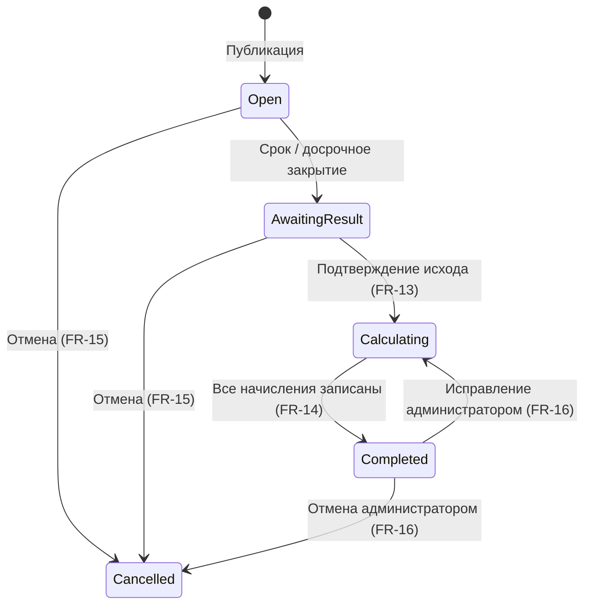

# Расчёт результатов и учёт начислений

**Issue:** #18 — docs: описать расчёт результатов и учёт начислений
**Основание:** README, FR-13–FR-18, FR-20
**Область:** схема данных, контракт API, правила идемпотентности,
сторнирования и фонового расчёта для модулей #19–#22
**Схема БД:** `app` (создана миграцией `001_initial_schema`)

---

## 1. Назначение и область

Документ определяет контракты между модулями подтверждения результата
(#19), отмены и исправления (#20), лидерборда (#21) и баланса/истории
(#22). Модули реализуются независимо против настоящих контрактов; чужие
модули (авторизация, профиль, прогнозы) подменяются заглушками до слияния.


## 2. Термины

| Термин | Определение |
| --- | --- |
| Прогноз | Запись пользователя о выборе исхода события (`predictions`) |
| Итоговый коэффициент | Коэффициент исхода, зафиксированный при закрытии приёма (`event_final_odds`) |
| Начисление | Строка журнала `kind='award'`, `points > 0` |
| Сторно | Строка журнала `kind='reversal'`, компенсирующая начисление |
| Ревизия | Номер расчёта события: `0` — первый, `1+` — исправления |
| Баланс | `SUM(points)` по журналу для пользователя |

## 3. Модель данных

### 3.1 `app.point_ledger` — журнал начислений

Единственный источник сведений о балансе. Отдельное поле баланса
отсутствует; произвольное редактирование баланса технически невозможно.

| Поле | Тип | Ограничения |
| --- | --- | --- |
| `id` | bigserial | PK |
| `user_id` | bigint | NOT NULL, FK → users |
| `event_id` | bigint | NOT NULL, FK → events |
| `prediction_id` | bigint | NOT NULL, FK → predictions |
| `points` | integer | NOT NULL |
| `kind` | text | NOT NULL, `CHECK (kind IN ('award','reversal'))` |
| `revision` | integer | NOT NULL, `CHECK (revision >= 0)` |
| `created_at` | timestamptz | NOT NULL DEFAULT now() |

Инвариант идемпотентности:

```sql
CREATE UNIQUE INDEX point_ledger_once
  ON app.point_ledger (prediction_id, revision, kind);
```

### 3.2 `app.event_results` — подтверждённый результат

| Поле | Тип | Ограничения |
| --- | --- | --- |
| `event_id` | bigint | PK, FK → events |
| `outcome_id` | bigint | NOT NULL, FK → event_outcomes |
| `revision` | integer | NOT NULL |
| `confirmed_by` | bigint | NOT NULL, FK → users |
| `confirmed_at` | timestamptz | NOT NULL |
| `reason` | text | NOT NULL, `CHECK (reason ~ '\S')` |
| `source` | text | NOT NULL |

### 3.3 `app.event_final_odds` — зафиксированные коэффициенты

Снимок коэффициентов на момент закрытия приёма. При исправлении результата
новые начисления рассчитываются по этим значениям (FR-16), а не по
текущему распределению.

| Поле | Тип | Ограничения |
| --- | --- | --- |
| `event_id` | bigint | NOT NULL |
| `outcome_id` | bigint | NOT NULL |
| `odds` | numeric(5,2) | NOT NULL |
| `revision` | integer | NOT NULL |

PK: `(event_id, outcome_id, revision)`.

### 3.4 Статусы результата

Статус «Рассчитывается» из ТЗ разделяется на два состояния: ожидание
подтверждения исхода и выполнение начислений.



## 4. Правила расчёта

- `K = min(N / n, 10)`, округление до двух знаков, 0.005 — вверх.
- `N = 0` → `K` равно числу вариантов, не более 10.
- `n = 0` → `K = 10`.
- Очки: верный прогноз — `100 × K`, неверный — `0`.
- `K` вычисляется целочисленно либо в SQL; в БД — `numeric(5,2)`,
  очки — `integer`.

Пример: 10 прогнозов, 8 за A, 2 за B → `K(A)=1.25`, `K(B)=5.00`;
при верном B — 500 очков каждому.

## 5. Контракт API

Общие положения: префикс `/api`; требуется `request.user`; проверка роли
на сервере при каждой операции; в тестах пользователь устанавливается
хуком.

### 5.1 Подтверждение результата (FR-13)

```
POST /api/events/:eventId/result
body: { outcomeId, reason, source }
200 → { eventId, outcomeId, revision, status: "calculating" | "completed" }
403 → не модератор категории и не администратор
409 → приём открыт / результат уже подтверждён
```

Транзакция: `SELECT ... FOR UPDATE` по событию → проверка статуса →
запись `event_results` → `result_status='calculating'` → запуск начисления.

### 5.2 Отмена (FR-15)

```
POST /api/events/:eventId/cancel
body: { reason }              // pattern: "\S"
200 → { eventId, status: "cancelled" }
```

Допустима из `Open` и `AwaitingResult` модератором категории или
администратором. Прогнозы сохраняются, начислений и штрафов нет.

### 5.3 Исправление результата (FR-16)

```
POST /api/events/:eventId/result/correct
body: { outcomeId, reason, source }
200 → { eventId, outcomeId, revision }
403 → не администратор
```

Транзакция: сторно предыдущей ревизии → начисление новой по
`event_final_odds` → `revision += 1` → обновление `event_results`.
Баланс, рейтинг и история пересчитываются из журнала.

### 5.4 Лидерборд (FR-17)

```
GET /api/leaderboard?categoryId=&limit=&offset=
GET /api/leaderboard/me
200 → { items: [{ rank, publicName, points, correctPredictions }] }
```

`rank` — `RANK()` (1, 1, 3), не `DENSE_RANK()`. Значения `SUM(points)`
и `RANK()` драйвер `pg` возвращает строками — приведение к числу явное.

### 5.5 Баланс и история (FR-18)

```
GET /api/me/balance        → { points, rank }
GET /api/me/predictions    → { items: [{ eventId, choice, odds, result, awarded }] }
```

История другого пользователя недоступна. `avatarUrl` формируется единым
хелпером `getAvatarUrl(user)`; до слияния модуля профиля — заглушка.

## 6. Инварианты и обработка сбоев

| Сценарий | Правило |
| --- | --- |
| Повторный запуск расчёта | `INSERT ... ON CONFLICT DO NOTHING` по `point_ledger_once` |
| Сбой в середине расчёта | Возобновление с точки остановки; уникальный индекс исключает задвоение |
| Параллельное подтверждение | Блокировка строки события; второй запрос получает `409` |
| Отмена | Только из `Open` и `AwaitingResult`; начислений нет |
| Исправление | Сторно прошлой ревизии + начисление новой; другие события не затрагиваются |
| Точность | Отменённые события не учитываются в числе верных прогнозов; отдельная метрика не реализуется |

## 7. Механизм фонового расчёта

Брокер в стеке отсутствует (`docker-compose.yml` — только Postgres).
Применяется таблица заданий в PostgreSQL:

- `app.scoring_jobs (event_id PK, revision, status, attempts, updated_at)`;
- воркер выбирает задания через `FOR UPDATE SKIP LOCKED`, обрабатывает,
  помечает `done`;
- при старте сервера и по таймеру подхватываются «зависшие» задания
  (`status='calculating'` старше N минут) — возобновление после сбоя.

Дополнительные сервисы не требуются. Альтернатива — pg-boss; отклонена
как лишняя зависимость.

## 8. Тест-план

1. Пример из ТЗ: 10 прогнозов, 8/2, верный B → по 500 очков.
2. Крайние случаи `n = 0`, `N = 0`.
3. Повторный запуск — новых строк нет.
4. Сбой в середине — после перезапуска начисление ровно однократное.
5. Исправление: 500 за B → сторно −500 ×2 и начисление 125 ×8.
6. Отмена открытого и ожидающего — начислений нет, прогнозы сохранены.
7. Лидерборд: ничьи 1, 1, 3; пустой рейтинг; фильтр по категории.
8. История: чужая недоступна; неверный прогноз — 0 без штрафа.

<!-- Мне очень стыдно перед вами за то, что я такой бездельник, извините, ребята -->
